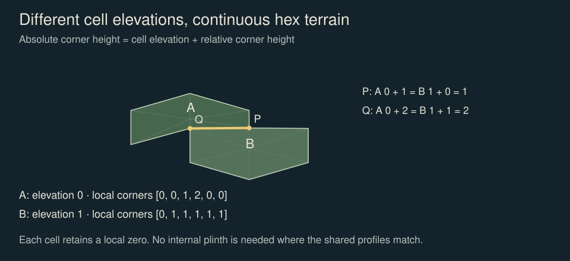
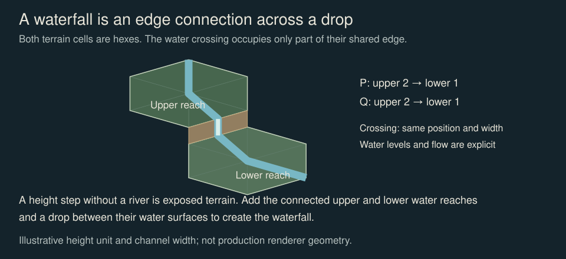
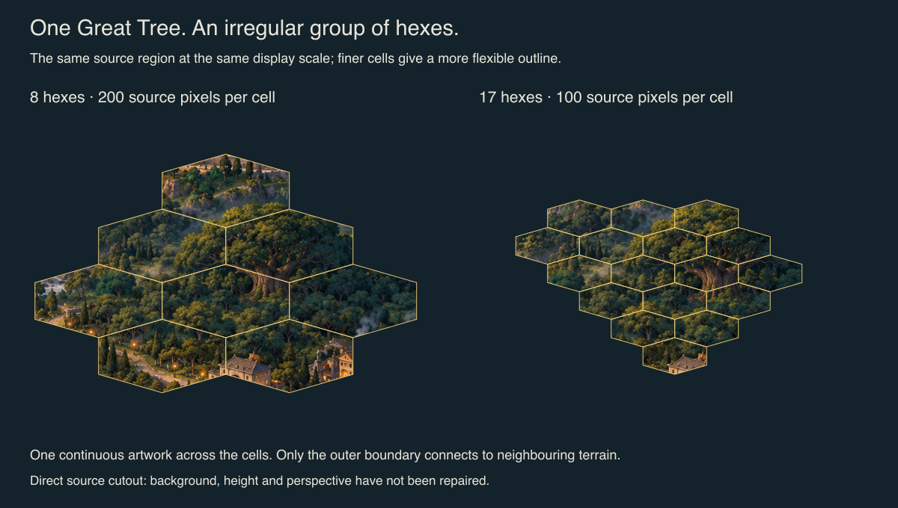

# Hex terrain composition

**Proposed.** Compose terrain from small pointy-top hexagonal cells, with six relative corner heights and a separate whole-cell elevation. Larger objects occupy connected groups of cells, while their artwork can remain continuous across internal boundaries. Neighbours join through explicit edge profiles and feature crossings; differences can reveal cliffs or waterfalls. This is the local design proposal and review specification, not an implemented extension of the tile contract.

## Authority and current compatibility

The current [tile contract](../../packages/tiles/src/contract.ts), [tile specification](tiles-and-buildings.md), [geometry decision](../decisions/GDR-KI-DESIGN-003-hex-grid-geometry.md) and [footprint decision](../decisions/GDR-KI-DESIGN-022-tile-loops-and-footprints.md) remain authoritative. Their existing geometry, footprint union, plinth and validation have not changed. In particular, a new irregular footprint cannot currently be written into a production manifest and pass the existing validator.

The owner confirmed the following direction on 19 October 2026: use hexes; investigate smaller construction cells for more flexible composition; describe height at each corner relative to a lowest corner of zero; raise a whole tile independently; support irregular compounds such as the Great Tree; derive exposed edges and waterfalls from neighbouring heights and connections; and keep the specification and supporting knowledge in `ki-design`. These directions are captured here without claiming formal **Agreed** status or a completed implementation.

The endpoint numbering, profile interpolation, suggested display sizes and illustrative record below are recommendations for review. Open implementation choices are tracked in [OPEN.md](../decisions/OPEN.md#hex-terrain-composition). Meaning changes still follow `ki-principal`. The Capital's existing seven-hex flower is preserved; an extraction study does not redefine that requirement.

## Model and terminology

- **Cell:** the smallest addressable hexagonal patch of ground. It has a map position and a surface, whether or not a building occupies it.
- **Surface:** the painted material and geometry of the ground. Material identity, shape and elevation are separate properties.
- **Artwork:** a terrain texture, building sprite or continuous scene. One artwork need not correspond to one cell.
- **Compound:** a placed object with a finite, edge-connected set of occupied cells. “Molecule” is a useful informal description of that arrangement.
- **Crossing:** a river, road or other explicit feature passing across a shared edge at a specified position.
- **Chunk:** a rendering or storage group. Chunk boundaries must not change terrain geometry, object occupancy or connections.

All new diagrams and worked examples for this proposal use hexes. Existing square candidates remain historical evidence of the production experiments.

## Mathematical reference

The [local mathematical specification](hex-terrain-mathematics.md) contains the complete projection, integer corner keys, neighbour rules, endpoint alignment, inverse picking, rounding, distance, logical rotation, normalisation, straight-profile face construction and compound operations needed for this proposal. It also defines the saved extraction method. External references are attribution and further background, not required implementation dependencies. Unsupported junction and foundation cases remain explicit pilot requirements.

## Coordinates and edge identity

Keep the existing pointy-top axial `(q, r)` cell coordinates and fixed camera. Use cube-coordinate algorithms where useful for distance, rotation of logical footprints and neighbourhood traversal. Do not introduce a separate coordinate grid for compounds.

For this proposal, number corners `c0` to `c5` clockwise, starting at the north corner in the unraised projected footprint. Edge `e0` joins `c0` to `c1`; in general `ei` joins `ci` to `c(i+1 mod 6)`. These are proposed local identifiers, not replacements for the contract's existing `orientation` values.

With positive `q` to the right and positive `r` towards the lower right, the proposed local edge mapping is:

| Edge | Corner endpoints | Neighbour offset |
| --- | --- | --- |
| e0 | c0 → c1 | (+1, −1) |
| e1 | c1 → c2 | (+1, 0) |
| e2 | c2 → c3 | (0, +1) |
| e3 | c3 → c4 | (−1, +1) |
| e4 | c4 → c5 | (−1, 0) |
| e5 | c5 → c0 | (0, −1) |

A shared edge has one map identity, derived from its two incident cells in a stable order. The opposite local edge is `(i + 3) mod 6`. Its endpoint order is reversed: A's first endpoint is B's second endpoint. Compare heights only after aligning both sides to the same world endpoints, called P and Q below. A world vertex has up to three incident cells.

## Corner heights and whole-cell elevation

For each cell, record an elevation `b` and six non-negative local heights `h0…h5`. At least one local height is zero. The absolute terrain height at corner `i`, in height units, is `Hi = b + hi`.

Normalise an existing set of absolute heights by taking `b = min(H0…H5)` and `hi = Hi − b`. Raising a whole cell by one unit increments `b` while preserving all six local heights. Changing a local corner reshapes the surface; renormalise if the last zero disappears. Several corners, or all six, may be zero.

Map elevation may be negative relative to the chosen world datum. Local heights remain non-negative. The physical distance of a height unit and its projected pixel rise are separate choices: zoom changes the pixel rise, not the stored elevation. The initial recommendation is integer terrain-height units; the unit size and any finer increments remain Open.

**Worked join:** A has elevation 0 and local heights `[0, 0, 1, 2, 0, 0]`. Across A's `e2`, its local endpoints are `c2` at absolute height 1 and `c3` at height 2. (In the mathematics' canonical P → Q order, which sorts the corner keys, `c3` comes first; the comparison is the same either way.) B is at axial offset `(0, +1)`, has elevation 1 and local heights `[0, 1, 1, 1, 1, 1]`. Its opposite edge is `e5`: B's `c0` meets A's `c2` at `1 + 0 = 1`, and B's `c5` meets A's `c3` at `1 + 1 = 2`. Both cells satisfy the zero-corner rule and the join is continuous.



### The surface between corners

Six corner heights specify the boundary, not the entire interior. A ridge, hollow or terrace needs an interior rule or additional geometry. The proposed first pilot uses straight edge profiles and six triangles meeting at a centre whose height is the mean of the six corners. This is a deterministic pilot convention, not a claim that every terrain should look like a six-triangle fan.

**What needs more than six heights.** Six corners fix the boundary only. A ridge or hollow across a cell needs an interior height; a terrace within one cell needs a break line; a river channel needs a carved bed; a cliff along part of an edge needs a non-straight profile; an overhang or cave cannot be a height field at all. The recommended pilot addition is a single optional centre height, used in place of the mean when present: seven values, the same fan, and it covers ridges, hollows and single peaks. Everything else is better carried by artwork or by splitting the feature across cells than by more stored heights.

Painted material follows that geometry: each flat-painted material tile is warped triangle by triangle onto the sloped fan, as the [mathematics](hex-terrain-mathematics.md#mapping-painted-material-onto-the-fan) defines. Buildings retain upright geometry and a defined ground contact. Warping a complete painting, including a building, onto a sloped terrain mesh would distort it. A building foundation must either fit the sampled ground, explicitly level it, or declare supported steps or terraces. For the pilot the recommended policy is a level pad: every member cell flat and at one elevation, with placement offering to level them (see [compound operations](hex-terrain-mathematics.md#compound-operations)). Steps and terraces remain Open.

## Shared edges and exposed faces

Under the pilot's straight-edge rule, a side's height along P → Q is the linear interpolation of its two endpoint heights. Let `dP = B(P) − A(P)` and `dQ = B(Q) − A(Q)`. Each height below is absolute, including the cell elevation.

| Endpoint differences | Result |
| --- | --- |
| dP = 0 and dQ = 0 | Continuous edge; no exposed cliff face |
| Equal, non-zero differences | Constant-height step |
| One difference is zero | A wedge-shaped exposed face |
| Same sign, unequal differences | A varying-height face with one side consistently higher |
| Opposite signs | Profiles cross; split the face where the higher side changes |

For opposite signs, the crossing is at `t = dP / (dP − dQ)` along P → Q. Build separate faces on either side of that point; a single self-crossing quadrilateral is invalid. The higher surface owns the exposed face on each segment. Rendering then determines whether the camera can see it.

Two endpoints suffice only for straight profiles. Curved, stepped or otherwise detailed boundary geometry must share an explicit profile or the same ordered intermediate samples. Two matching endpoints alone cannot guarantee that such edges meet along their full length.

An ordinary internal join has no decorative plinth between its cells. A real height discontinuity can expose rock, soil or an explicit retaining treatment. An island's outside boundary may expose a cutaway down to a declared datum. That visible depth is not automatically the height difference to a neighbour, and the current fixed-plinth renderer is not yet replaced by this proposal.

### What the camera shows

Only the higher cell's lower-front edges (e2 and e3) ever show a cliff face. East and west steps (e1, e4) are edge-on and show no face, so their art needs a darkened edge stroke to read as a step; drops away from the camera (e0, e5) are hidden behind the higher cell. The [mathematics](hex-terrain-mathematics.md#what-the-fixed-camera-can-show) gives the table, the lit and shaded tones and the draw order. This removes most visibility work: a renderer draws at most two faces per cell.

### Where three cells meet

Each cell keeps its own corner heights. Terrain is continuous at a world vertex where the incident stored heights are equal, and a cliff where they are not; nothing needs reconciling or storing twice.

With straight profiles and vertical faces the junction closes by construction: all faces meeting at the vertex lie in vertical planes through it, each covering the interval between its two incident heights, so no corner cap is needed ([proof](hex-terrain-mathematics.md#closing-three-cell-junctions)). Caps, and explicit cases for cliffs meeting ramps, become necessary only when faces stop being vertical planes (bevels, thickness, overhangs) or when a fixed sprite stands in for a computed face. The pilot excludes both. Independent edge sprites without this rule are insufficient. Boundary identity and ownership must remain stable across chunk boundaries.

## Rivers, roads and waterfalls

Height says what can be exposed; a feature declaration says what actually crosses the edge. The recommended crossing record contains the feature type, connection identity, position along P → Q, width in world units, and the relevant level and direction information. Reversing endpoint order also reverses the crossing parameter: `t` becomes `1 − t`.

For water, record or derive river-bed level and water-surface level separately from surrounding terrain height. Match the crossing position, width and receiving reach on the neighbour. River flow follows an explicit directed connection and compatible water levels. A terrain drop without a river crossing is a cliff, not a waterfall.

For the pilot, accept a crossing only where both sides are level across it, so the water surface is the cell surface and no separate levels are stored, and accept a waterfall only over the upper cell's e2 or e3 edge, where the camera can see it ([pilot simplification](hex-terrain-mathematics.md#feature-crossings-and-waterfalls)). Separate bed and water levels follow once that holds.

If the connected upper water surface drops to a lower receiving water surface, create a waterfall connector between them, with rock exposure around it and an explicit receiving-water treatment. Its width and drop follow the water connection, not the entire hex edge. Keep painted foam and spray within the connector's declared extent. Roads crossing a discontinuity similarly need a supported ramp, stairs, bridge or a rejected connection; they cannot silently float over it.



## Compounds and small construction cells

A compound stores a stable id, anchor cell, occupied axial offsets and artwork placement. Its occupied offsets form an arbitrary edge-connected shape: a pair, an irregular tree footprint or a larger civic complex. The origin `(0, 0)` is an occupied anchor cell. Internal edges retain any needed terrain and flow relationships, but do not acquire visible seams merely because the artwork spans several cells.

One continuous artwork can cover the compound, or separate ground, structures and details can be assembled there. Occupancy, visual overhang, ground contact and interaction bounds are distinct. A canopy extending beyond its trunk's contact patch does not automatically make every overhung cell impassable. Their exact occupancy policy must be explicit before implementation; existing overhang limits still apply to current production art.

Draw a compound in the pass of its front-most row. For the pilot, that requires the cells just in front of its members, within its rows, to be neither raised above its base nor occupied; the [draw order](hex-terrain-mathematics.md#draw-order) states the rule, and per-row slicing of compound art is the general alternative. Footprints with holes are rejected in the pilot.

Place and move the compound as one object while testing occupancy and connections for every member cell. Handle external boundary edges individually. A shared placement elevation may raise the whole compound; member surfaces still normalise their local corner heights. A common building foundation spanning several cells must not be independently warped by each member cell.

Logical footprint rotation is possible in the grid, but existing painted art has fixed upper-left light. Do not rotate its bitmap. A differently oriented structure needs compatible artwork. A cluster of small hexes generally has a stepped boundary, not the straight sides of one larger regular hexagon.

The Capital's canonical flower remains a separate constraint. **Hexes do not nest:** no set of smaller hexes exactly fills a larger one, and the closest fit, the seven-hex flower, is turned about 19.1° from its parent hex. A finer construction grid beneath the current semantic hex could therefore never share its boundaries, and every semantic-cell edge would cut through small cells. The recommendation is one grid: the construction cell _is_ the semantic hex, and the Capital stays seven of them. That also ties the grid's scale to the painting. The Capital's hilltop forum is about 420 source pixels across, and a seven-hex flower is three cells wide, so the matching sampling width is about 140 pixels. At that width the study's own selection rule gives the Great Tree 12 cells: irregular, and between the 8-cell and 17-cell comparisons. The 17-cell tree belongs to a 100-pixel grid, on which the Capital's hilltop would need about 19 cells (a hex of radius two), which the seven-hex rule excludes. This is a sampling estimate for review, not a world size. A finer extraction grid must not silently redefine the Capital's footprint.

### Size and resolution

Keep four quantities distinct: logical cell size in the world, sampling width in a source painting, authored asset resolution and displayed screen size. The existing raster sizes are defined by `tileGeometry` and the tile specification; this proposal does not replace them.

There is no chosen physical cell size yet. The recommended starting point is one ground cell as the smallest logical unit, with buildings free to occupy several cells. For a display pilot, try 128–256 CSS pixels per cell in a detailed editing view, and a simplified 64-pixel overview. These are unvalidated recommendations, not established minimum sizes or a change to the asset contract. Check pointer, touch, keyboard and high-density display behaviour under the existing [accessibility rules](accessibility.md).

Smaller cells give more precise footprints and more placements, but also more boundaries to compose, more records to manage and less source detail per crop. The Great Tree study covers a similar source region with 8 coarse cells or 17 finer cells. Its source-pixel counts do not determine the eventual world scale or interaction size.



## Extracting the selected Arcadia painting

The owner confirmed [`docs/briefs/references/arcadia.png`](../briefs/references/arcadia.png) as the original to investigate. Its small reference copy remains the source for compact generation requests. The [extraction study](../../+/art/2026-10-19-arcadia-hex-composition-study/NOTES.md) preserves the overlay, candidate compounds, Great Tree comparison and sampling method.

Overlaying a regular projected hex grid is a sampling operation. It does not recover terrain elevations, remove perspective or reveal ground hidden by a canopy or roof. The painting has depth, atmospheric scale and overlapping scenery; a screen-space cutout is not yet an independently movable terrain cell. Cutting and reassembling the original positions reconstructs the image, not a general tile set.

Preserve useful painted surfaces and continuous complexes, then reconstruct their ground contact, height mesh and outer connections. Remove captured sky behind elevated structures; recover or repaint occluded ground; keep upright buildings separate from surfaces that will deform. Some regions may need substantial repair. Do not promise that every candidate will work with minor edits, or turn the sampling grid into an asserted height map.

## Illustrative data shape

This is review notation, not a JSON schema, package export or valid current tile manifest:

```text
cell:
  position: axial q, r
  elevation: b
  corners: [h0, h1, h2, h3, h4, h5]  # minimum is zero
  surface: terrain id and material reference

shared boundary:
  identity: two incident cells in canonical order
  profiles: absolute endpoint heights for each incident surface
  crossings: feature id, position, width, levels and direction
  junctions: references to the two world-vertex treatments

compound:
  id: stable object id
  anchor: occupied axial cell
  cells: connected axial offsets from anchor
  art: layer references, anchors and supported orientation
  contact: ground-contact and foundation requirements
  boundary: external connections derived from member cells
```

## Pilot and acceptance

### Pilot 0: the smallest useful test

**Proposed.** One pure function and one fixture, with no art, no contract change and no renderer migration:

- a `renderTerrainSvg` beside `renderArchipelagoSvg` in `@knowledgeislands/hexmap`, drawing cells from `(q, r, b, h0…h5, material)` with flat token colours;
- the mean-centre fan, visible e2 and e3 faces in lit and shaded rock tones, outside faces down to the datum with the existing plinth below, and `isoSort` draw order;
- a 19-cell fixture island containing: equal joins, a cell raised by one unit, a sloped shared edge, a tapered cliff, an edge whose higher side swaps, a three-cell junction with three different heights, an east step, one level river crossing and one front-edge waterfall, a seven-cell level-pad compound as a placeholder block, and a three-cell tree compound on a slope;
- unit tests for every check in [mathematical acceptance](hex-terrain-mathematics.md#mathematical-acceptance-checks), plus: the all-zero map draws the same top faces and plinths as the current renderer, every visible face's endpoints coincide with its two surfaces' edges, and the placement rules reject a hole, a non-level pad and a raised cell in front of a compound.

Its output is one review board. It proves the geometry, the visibility rules and the draw order before any painted material is involved, and it costs a few hundred lines of TypeScript.

### Later stages

Pilot 1 warps flat-painted Ancient materials onto the same fixture and judges whether the painting survives the slopes; that is the result that decides whether this model suits the painted style. Pilot 2 adds an Arcadia-derived patch beside new material. Chunking, depth-aware picking on raised terrain, continuous heights, layered occupancy and compound rotation stay out of the pilots until a need appears.

Before changing a production schema, demonstrate all of the following with hex-only examples:

1. A single ground hex, an irregular tree compound and a multi-cell civic complex, with selection and placement at proposed detailed and overview sizes.
2. Equal-height joins, a cell raised by one unit, a sloped shared edge, a tapered cliff and a crossing of two edge profiles.
3. A three-cell junction, with continuous terrain and with two different exposed height steps; no holes or duplicate faces.
4. A river across a continuous join and a narrow waterfall into a lower reach, with aligned crossing positions and explicit water levels.
5. A building across more than one terrain cell, with correct foundation contact and foreground occlusion.
6. An Arcadia-derived patch beside newly painted material, with consistent light, scale and edge treatment.
7. Terrain and crossings that remain identical when divided into different render chunks, with deterministic ownership and acceptable rendering cost.

The pilot must make the limitations visible. Archive original art separately from repaired derivatives and record source, prompt where applicable, transformation, dimensions, anchors and deviations. Art remains unlicensed under [GDR-KI-DESIGN-035](../decisions/GDR-KI-DESIGN-035-art-unlicensed-until-recorded.md).

## Knowledge and review routes

- [Research and design rationale](../briefs/hex-terrain-research.md): primary references, adaptations, evidence and limitations.
- [Ancient surface style](../briefs/tile-set-ancient.md): palette, lighting, material and silhouette guidance.
- [Local extraction and edge diagrams](../../+/art/2026-10-19-arcadia-hex-composition-study/NOTES.md): source metadata and reproducible geometry.
- [Open choices](../decisions/OPEN.md#hex-terrain-composition): what still needs evidence or a decision.
- [Claude Design handoff](../briefs/hex-terrain-claude-handoff.md): review scope and steering request.
